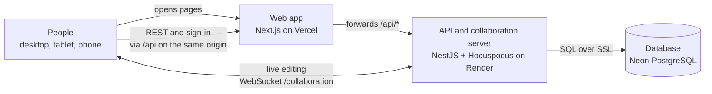
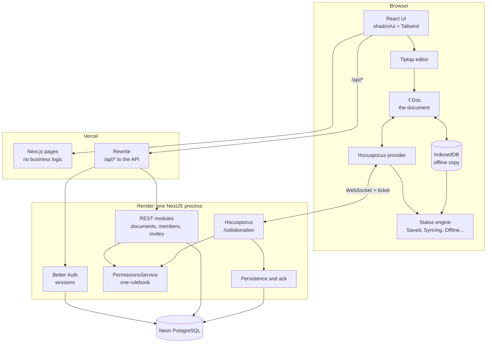
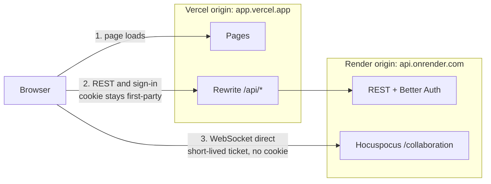
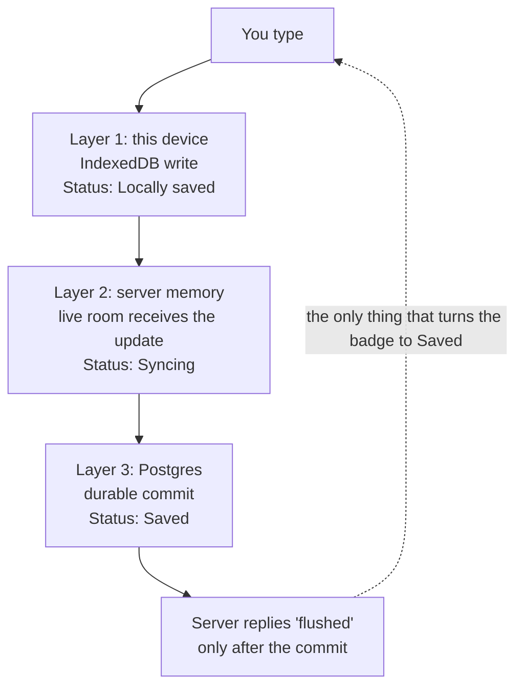
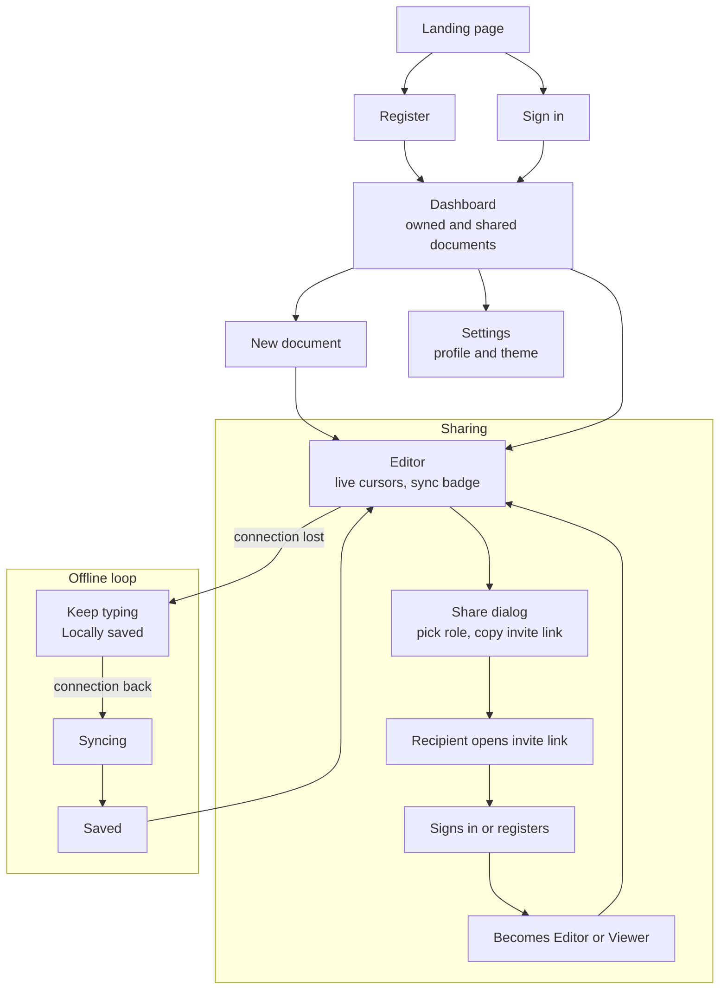
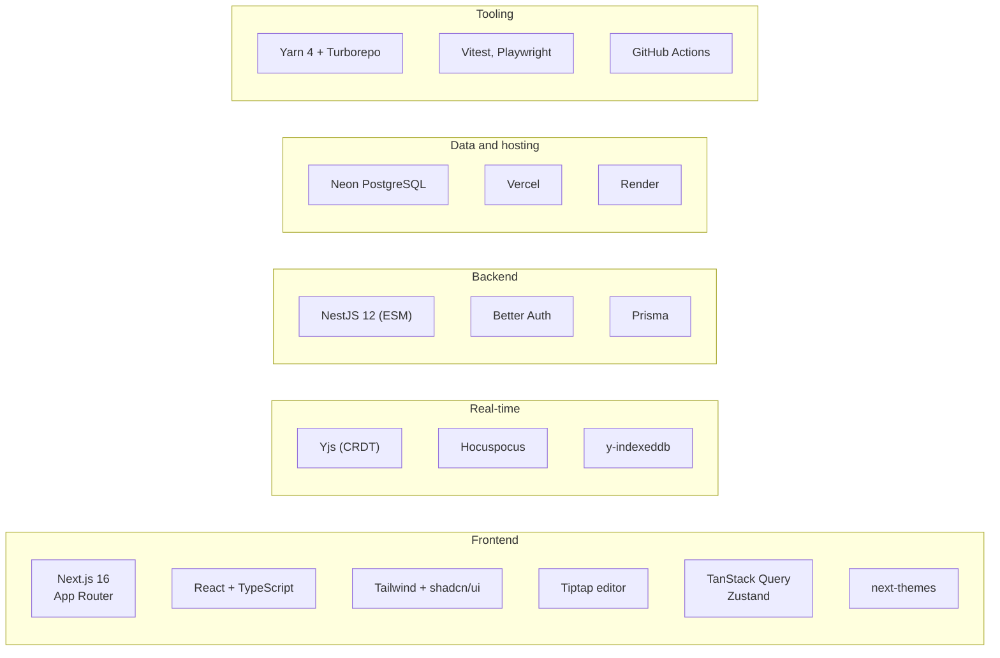
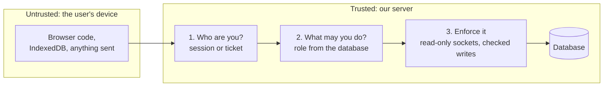
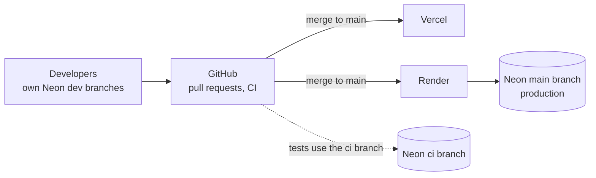

# SyncSpace: High-Level Architecture

> **Status:** v2 · **Updated:** 2026-11-22
> **Audience:** anyone who wants to understand SyncSpace in 10 minutes (interviewers, new contributors).
> **Next:** [Low-level design](./architecture-lld.md) for modules, data model, protocols and tests.
> **Requirements source:** [project-brief.md](./project-brief.md)

**Reading notes**

- Diagrams are Mermaid, so GitHub renders them in the repo.
- **⚠ Verify** marks anything that depends on a third-party library or a free-tier limit. Confirm it against current official docs before relying on it.
- Free-tier limits were last checked in November 2026 and change often. Re-check before you deploy.

---

## 1. What we are building

SyncSpace is a collaborative document workspace that keeps working when the network does not. Several people edit one rich-text document at the same time. When someone loses connection, they keep typing, and their edits merge back when they return.

The app makes three promises:

1. **Keep working:** editing continues offline.
2. **Collaborate naturally:** many people edit one document with no overwritten work.
3. **Know the truth:** the screen always says whether your work is on this device, on its way, or safely stored on the server.

> A connected WebSocket is never proof that work is saved. "Saved" appears only after the database confirms it.

---

## 2. Scope: one-week MVP versus future

We build a small number of features reliably, not many half-working ones.

| Area | In the one-week MVP | Future enhancements |
|---|---|---|
| Accounts | Email and password sign-up, sign-in, sign-out, session, profile | OAuth, password reset by email, email verification, MFA |
| Documents | Create, list (owned and shared), search by title, rename, delete | Folders, templates, import and export |
| Editor | Headings, bold, italic, underline, strike, lists, quote, code, link, divider | Tables, images, task lists, slash commands |
| Collaboration | Live editing, presence, cursors, selections | Comments, mentions, notifications |
| Offline | Edit offline in an open tab, local persistence, auto-reconnect and merge | Reopen a closed tab offline (app-shell caching) |
| Status | Eight explicit sync states driven by a durable-save acknowledgement | Per-change counts, history of sync events |
| Sharing | Owner, Editor and Viewer roles, **member-only invite links** | Email invitations, public links, teams |
| Persistence | Update log in Postgres, restart recovery, snapshots if time allows | Version history and restore, compaction worker |
| UI | Responsive (320 px to desktop), light and dark theme, English | More languages, accent themes |
| Ops | Free deploys, CI, health checks, README demo video | Metrics, tracing, alerts, backups automation |

---

## 3. Constraints that shaped the design

| Constraint | What we did about it |
|---|---|
| **Zero budget** | Only free tiers: Vercel, Render, Neon, GitHub. No Redis, no queues, no email provider, no custom domain. |
| **One week, two developers** | One repo, one backend process, shared libraries only where needed. Everything else is a future enhancement. |
| **Free hosts sleep when idle** | Design for cold starts: a wake-up request on page load and a status badge that says "Connecting" instead of failing. |
| **Public GitHub repo** | No secrets in code, least-privilege CI, demo accounts hold no real data. |
| **Frontend and backend on different domains** | Proxy REST and auth through the frontend origin, and connect the WebSocket directly with a short-lived ticket. |
| **Must work on phones** | Mobile-first layout, 44 px touch targets, a docked editor toolbar. |
| **Interviewers may not run it** | A README video and an easy demo path (see §13). |

---

## 4. System context

Who and what SyncSpace talks to.

---

## 5. Architecture at a glance

One frontend, one backend process, one database. Every document is a CRDT (Yjs), kept both in the browser and on the server.

**Who owns what**

| Component | Owns | Does not own |
|---|---|---|
| Next.js | Pages, routing, theme, client state | Authorization, durable data |
| Better Auth (in the API) | Users, passwords, sessions | Document permissions |
| NestJS REST | Business rules, authorization, document metadata | Live document content |
| Hocuspocus | Live Yjs sync, presence, connections | Business rules (it asks `PermissionsService`) |
| PostgreSQL | The durable truth | Cursors and presence |
| IndexedDB | The offline copy and pending-work marker | Anything proving server persistence |

---

## 6. How requests travel

Two different paths, chosen because Vercel cannot hold long-lived sockets and the two hosts live on different domains.

1. **Pages** come from Vercel.
2. **REST and sign-in** look like same-origin calls, because Vercel forwards `/api/*` to Render. The session cookie is first-party, so Safari and Brave do not block it, and no CORS setup is needed.
3. **The WebSocket** connects straight to Render. Before connecting, the browser asks `POST /api/collaboration/tickets` (through the proxy, with its session) for a 60-second ticket and presents that. The server still reads the user's role from the database.

**Free-tier behavior to design around** (⚠ Verify the current limits before you deploy)

| Host | Behavior |
|---|---|
| Render free web service | Sleeps after about 15 minutes with no inbound traffic, and WebSocket messages count as traffic. Waking takes about a minute. Redeploys and restarts close all sockets. |
| Neon free | Compute sleeps when idle and wakes on the next query. |
| Vercel Hobby | Static and serverless hosting; no long-lived sockets. |

Consequences: ping `/api/health` when the app loads to wake Render early, show **Connecting** (not an error) during a cold start, flush pending stores on shutdown, and warm everything a minute before a demo.

---

## 7. The core idea: three layers of "saved"

This is what makes SyncSpace different from a basic CRUD editor.

- Each layer proves something different. Only the third proves the work survives a server restart.
- The server's acknowledgement is a message the client sends and matches (`flush` and `flushed`), not a side effect of the socket being open.
- Details are in [LLD §6](./architecture-lld.md#6-persistence-and-the-save-acknowledgement).

---

## 8. Key user journeys

All screens are designed in the UI design canvas. Export screenshots into `docs/design/` so the repo carries them.

---

## 9. Technology choices and why

| Choice | Why | Trade-off |
|---|---|---|
| **Yjs (CRDT) over OT** | Any order of edits merges, duplicates are harmless, and long offline periods are cheap. One mechanism handles live and offline. | Document metadata grows; compaction or snapshots handle it later. |
| **Hocuspocus** | Ready-made Yjs server with auth, load and store hooks | Its store hook is debounced, so we build our own flush-and-confirm. |
| **NestJS backend** | Modules and guards map onto one shared permissions rulebook; Swagger built in | More boilerplate; ESM and test-metadata quirks |
| **Next.js frontend** | Landing page, routing, layouts and free Vercel deploys. Vite would also work for the editor alone. | App Router needs care for a service worker later |
| **Better Auth inside the API** | One session system, cookie sessions you can revoke instantly | Needs an early integration spike with Nest |
| **Neon over Supabase** | Plain Postgres with a branch per developer; we do not need Supabase's bundled auth or realtime | Cold starts, free-tier limits |
| **No Redis, one backend instance** | In-memory rooms need one process; zero cost | A deploy briefly drops connections; scaling needs Redis later |
| **Modular monolith** | Two developers, one deploy, instant revocation | Shared scaling; modules keep a clean split for later |

---

## 10. Security at a glance

1. **Never trust the client.** Identity comes from the session or ticket, and the role comes from the database.
2. **Hiding a button is not authorization.** Every write path checks the role on the server.
3. **One rulebook.** REST and WebSocket both call `PermissionsService`, so they cannot disagree.
4. **Presence is ephemeral.** Cursors are never written to the database.
5. **Local data is isolated** per account and cleared on logout (with a warning if work is unsynced).
6. **Public-demo guardrails:** rate limits, size limits, Origin checks and content sanitizing ([LLD §9](./architecture-lld.md#9-security-checklist)).

---

## 11. Responsive design and UX architecture

| Width | Layout |
|---|---|
| 320 to 639 px | Bottom navigation, full-screen editor, docked scrolling toolbar, bottom-sheet dialogs |
| 640 to 1023 px | Icon-rail or collapsible sidebar, condensed toolbar, centered dialogs |
| 1024 px and up | Persistent sidebar, full toolbar, presence and sync status in the header |

- **Tokens, not hardcoded colors:** shadcn CSS variables with Tailwind. Light and dark themes through `next-themes` (Light, Dark, System).
- **Type:** Inter for the interface and editor, Geist Mono for code. Editor text 16 px with generous line height, column capped near 720 px.
- **Accessibility:** semantic HTML, keyboard navigation, visible focus, and sync status never shown by color alone (icon plus words, with an `aria-live` announcement).
- **English only now, i18n-ready:** every user-visible string lives in one place, and the API sends stable error codes, not English sentences.

---

## 12. One-week delivery plan

Two developers. The scaffold, CI and hooks are already done ("Day 0"). Each day ends with something demonstrable. The plan is tight, so the cut list below protects the core.

| Day | Developer 1 (frontend) | Developer 2 (backend) | Done when |
|---|---|---|---|
| **1** | Theme, tokens, app shell, auth pages | Neon dev branches, Prisma schema, Better Auth inside Nest (**spike**), `/api` prefix, health checks | Register, sign in and refresh work through the proxy locally |
| **2** | Dashboard, document list, create, rename, delete, search | Document REST + `PermissionsService`, Swagger | Create and manage documents; no access to others' private ones |
| **3** | Tiptap editor, toolbar, Yjs provider, presence | Hocuspocus on the Nest server, ticket endpoint, `onAuthenticate`, load and store (**ack spike**) | Two browsers edit one document live |
| **4** | IndexedDB, pending marker, sync status engine, offline banner | Flush handler, persistence queue, restart recovery | Offline edit, reconnect, then **Saved** only after the commit |
| **5** | Share dialog, invite page, role-aware editor (viewer read-only) | Members and invite-link endpoints, revocation closes sockets | Owner, Editor and Viewer behave the same across REST and WebSocket |
| **6** | Responsive pass, empty and error states, dark-mode fixes | **Deploy the skeleton early if not done on Day 1**, rate limits, shutdown flush, CI tests | Live URL works with two accounts |
| **7** | Playwright tests, demo polish, README video | Integration tests (restart, DB failure), docs | Demo-ready; tag the release |

**Rule:** deploy a skeleton (login plus a WebSocket round trip) on Day 1 or 2, not at the end. Cross-origin and cold-start problems cost an hour early and a day late.

**If you fall behind, cut in this order**

1. Snapshots and compaction (the update log alone is enough for a demo).
2. Invite expiry options and use caps (keep one default link).
3. Settings and profile polish.
4. Tablet-specific layout tuning.
5. App-shell caching (it is already a stretch goal).

**Never cut:** persistence acknowledgement, permission checks on the WebSocket, the sync status badge, per-account local data isolation.

---

## 13. Demo and deployment plan (zero budget)

- Deploys happen automatically on merge to `main`. Local work and CI never touch the production branch.
- **For interviewers**, include in the README:
  1. A 60-second video or GIF: two users editing, one going offline and editing, then reconnecting while the badge moves from Locally saved to Saved.
  2. The live URL, plus a cold-start warning ("the first load can take up to a minute").
  3. Open registration with any email (email verification is off), and two seeded demo accounts so one person can try two windows. The demo accounts hold no real data and have profile and password changes disabled.
  4. A list of what is deliberately disabled (password reset, email invites).
- Guest sessions without sign-up are a future enhancement.

---

## 14. Design highlights to talk about in interviews

1. **Honest status.** "Saved" means committed to Postgres, proven by an acknowledgement the client matches. I built a flush-and-confirm protocol because the editor's store hook is debounced.
2. **Why CRDT, not OT.** Offline-first needs merging any order of edits without a central transformer. Yjs also makes duplicates and replays harmless.
3. **One permission rulebook** shared by REST and the WebSocket, with revocation that closes live connections immediately.
4. **Solving cross-origin on a zero budget:** proxy REST through the frontend origin for first-party cookies, and use a short-lived ticket for the socket.
5. **Failure-first thinking:** twelve failure scenarios (restart, database down, expired session, account switch) mapped to tests.
6. **Status as a pure function.** The sync badge is derived from inputs by one function, so every state is unit-testable.
7. **Honest limits.** The README states what is not guaranteed: free-tier cold starts, single instance, no encryption of local data.

Do not claim production scale, performance numbers or guarantees you have not measured.

---

## 15. Future enhancements

| Theme | Items |
|---|---|
| Accounts | OAuth, email verification, password reset by email, MFA |
| Sharing | Email invitations, public links, guest sessions, teams and workspaces |
| Collaboration | Comments, mentions, notifications, activity feed |
| Editor | Tables, images, task lists, slash commands, export to PDF or Markdown |
| History | Version history and restore (snapshots are already designed to support it) |
| Offline | App-shell caching so a closed tab reopens offline |
| Reliability | Compaction worker, automated encrypted backups, metrics and alerts |
| Scale | Separate collaboration service, Redis for multiple instances |
| Product | i18n with more languages, mobile app, templates |
| AI | Summaries and Q&A that read only documents the user may access |

---

## 16. Decision log

| ID | Decision | Why |
|---|---|---|
| ADR-001 | Yarn 4 + Turborepo monorepo, modular monolith | Two developers, shared tooling, one deploy |
| ADR-002 | CRDT (Yjs), no OT | Simplest way to get live and offline editing |
| ADR-003 | Better Auth inside `apps/api`, cookie sessions | One revocable session system |
| ADR-004 | Hocuspocus on the same NestJS server | One free deployment, instant revocation |
| ADR-005 | Save acknowledgement by flush with nonce, epoch and state vector | Honest "Saved" that survives restarts |
| ADR-006 | One `PermissionsService` for REST and WebSocket | They can never drift apart |
| ADR-007 | Vercel rewrite for REST and auth, direct WebSocket with a 60-second ticket | Works on free hosting without a domain |
| ADR-008 | Local database names `syncspace:{userId}:{documentId}`, plus a pending marker in a metadata store | No cross-account leakage, honest status after refresh |
| ADR-009 | Member-only invite links (hashed tokens, URL fragment, multi-use, 7-day default) | No email provider needed, identity preserved |
| ADR-010 | Neon only, per-developer branches, no Docker | Simplicity and zero cost |
| ADR-011 | Document owner stored in `Document.ownerId` only | One source of truth |
| ADR-012 | Offline promise: edit in an open tab, survive reload, merge on reconnect. App-shell caching is a stretch goal | Keeps the week realistic |
| ADR-013 | Single backend instance, no Redis | In-memory rooms need one process |
| ADR-014 | Sync status derived by a pure function from inputs | Testable, cannot reach impossible states |

---

## 17. Assumptions and things to verify early

| # | Item | When |
|---|---|---|
| 1 | Better Auth works behind the Vercel rewrite (base URL, trusted origins, `Set-Cookie` passthrough) and inside Nest | Day 1 spike |
| 2 | Hocuspocus hooks, stateless messages, custom close codes and read-only connections in the pinned version | Day 3 spike |
| 3 | Message order on one connection, including a delete followed immediately by a flush | Day 3 spike |
| 4 | Vercel's timeout for rewrites to a cold Render service | Day 1 deploy |
| 5 | Free-tier limits on Render, Neon and Vercel | Before first deploy |
| 6 | `y-indexeddb` update hooks and clearing, so the pending marker and logout purge work | Day 4 |
| 7 | Safari may evict unused site storage; request persistent storage and warn if it is not granted | Day 4 |
