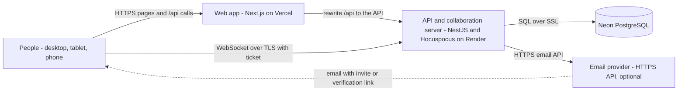
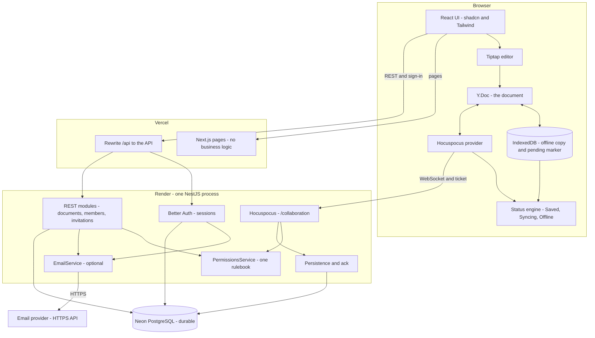
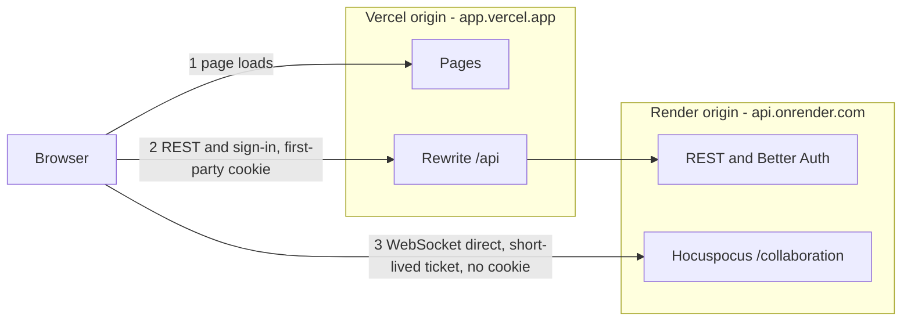
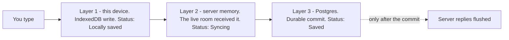
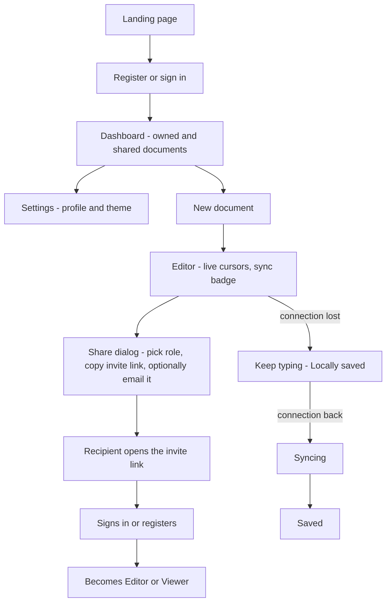
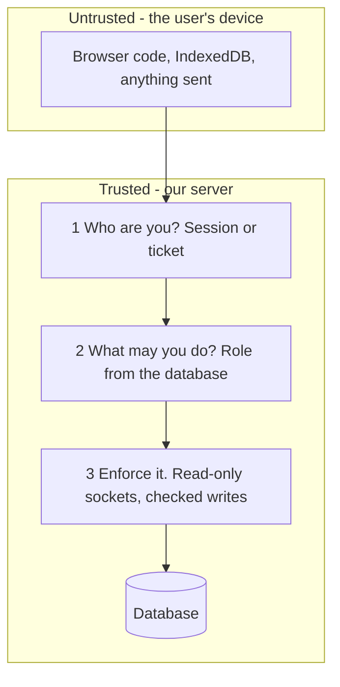
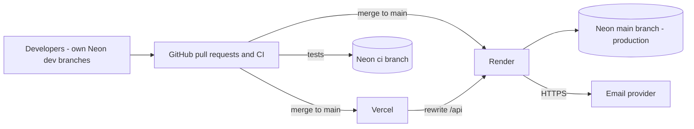

# SyncSpace: High-Level Architecture

> **Status:** v3.1 · **Updated:** 2026-11-25 · **Decisions D1, D2 and D4 are resolved** (section 17) · **Audience:** anyone who wants to understand SyncSpace in about 15 minutes (new contributors, reviewers).
> **Next:** [Low-level design](architecture-lld.md) for modules, data model, protocols and tests.
> **Requirements source:** [project-brief.md](project-brief.md)

## Reading notes

- Diagrams are Mermaid, so GitHub renders them in the repo.
- **⚠ Verify** marks anything that depends on a third-party library or a free-tier limit. Confirm it against current official docs before relying on it. Never guess a package API.
- Free-tier facts were last checked in November 2026 and change often. Re-check before you deploy.
- **Open decisions** that need an owner's approval are collected in [section 17](#17-open-decisions-needing-approval).

---

## 1. What we are building

SyncSpace is a collaborative document workspace that keeps working when the network does not. Several people edit one rich-text document at the same time. When someone loses connection, they keep typing, and their edits merge back when they return.

The app makes three promises:

1. **Keep working:** editing continues offline.
2. **Collaborate naturally:** many people edit one document with no overwritten work.
3. **Know the truth:** the screen always says whether your work is on this device, on its way, or safely stored on the server.

> A connected WebSocket is **never** proof that work is saved. "Saved" appears only after the database confirms it.

## 2. Scope: MVP versus future

We build a small number of features reliably, not many half-working ones.

| Area | In the MVP | Future enhancements |
| --- | --- | --- |
| Accounts | Email and password sign-up, sign-in, sign-out, persistent session, profile. Accounts are active immediately | Email verification, password reset by email, OAuth, MFA |
| Documents | Create, list (owned and shared), search by title, rename, delete | Folders, templates, import and export |
| Editor | Headings, bold, italic, underline, strike, lists, quote, code, link, divider | Tables, images, task lists, slash commands |
| Collaboration | Live editing, presence, cursors, selections | Comments, mentions, notifications |
| Offline | Keep editing in an **open tab**, local persistence, auto-reconnect and merge (decision D1) | Reopen a closed tab or refresh while offline (needs app-shell caching) |
| Sync status | Eight explicit states driven by a durable-save acknowledgement | Per-change counts, sync history |
| Sharing | Owner, Editor, Viewer roles; invite links | Public links, teams |
| Email (optional) | Behind `EMAIL_ENABLED`: **invite links only**, sent through an **HTTPS email API** (decision D4). Nothing else is emailed | Email verification, password reset, notification and digest emails |
| Persistence | Update log in Postgres, restart recovery, snapshots if time allows | Version history and restore, compaction worker |
| UI | Responsive (320 px to desktop), light and dark theme, English | More languages, accent themes |
| Ops | Free deploys, CI, health checks, README demo video | Metrics, tracing, alerts, backup automation |

The app must be **fully usable with email switched off**. Email is a convenience, never a dependency.

## 3. Constraints that shaped the design

| Constraint | What we did about it |
| --- | --- |
| Zero budget | Free tiers only: Vercel, Render, Neon, GitHub, and a free HTTPS email API. No Redis, no queues, no custom domain |
| 14 days, two developers | One repo, one backend process, shared libraries only where needed. Everything else is a future enhancement |
| Free hosts sleep when idle | Wake the API on page load, and show **Connecting** instead of failing |
| Render free blocks outbound SMTP (ports 25, 465, 587) | Send email through an HTTPS API (port 443), never SMTP |
| Frontend and backend on different domains | Proxy REST and sign-in through the frontend origin; connect the WebSocket directly with a short-lived ticket |
| Public GitHub repo | No secrets in code, least-privilege CI, demo accounts hold no real data |
| Must work on phones | Mobile-first layout, 44 px touch targets, a docked editor toolbar |
| Reviewers may not run it | README video and an easy demo path (section 13) |

## 4. System context

Who and what SyncSpace talks to.

## 5. Architecture at a glance

One frontend, one backend process, one database. Every document is a CRDT (Yjs), kept both in the browser and on the server.

**Who owns what**

| Component | Owns | Does not own |
| --- | --- | --- |
| Next.js | Pages, routing, theme, client state | Authorization, durable data |
| Better Auth (inside the API) | Users, passwords, sessions | Document permissions |
| NestJS REST | Business rules, authorization, document metadata, invitations | Live document content |
| PermissionsService | **The single rulebook** for who may do what | Identity (that comes from the session or ticket) |
| Hocuspocus | Live Yjs sync, presence, connections | Business rules (it asks PermissionsService) |
| EmailService | Turning a message into one HTTPS call | Deciding who gets email; it never blocks a user action |
| PostgreSQL | The durable truth | Cursors and presence |
| IndexedDB | The offline copy and the pending-work marker | Anything that proves server persistence |

## 6. How requests travel

Two different paths, chosen because Vercel cannot proxy long-lived sockets and the two hosts live on different domains.

1. **Pages** come from Vercel.
2. **REST and sign-in** look like same-origin calls, because Vercel forwards `/api/*` to Render. The session cookie is first-party, so browsers that block third-party cookies still work, and no CORS setup is needed.
3. **The WebSocket** connects straight to Render. Before connecting, the browser asks `POST /api/collaboration/tickets` (through the proxy, with its session) for a 60-second single-use ticket and presents it in the first message. The server still reads the user's role from the database.

**Free-tier behavior to design around** (⚠ Verify the current limits before you deploy)

| Host | Behavior |
| --- | --- |
| Render free web service | Spins down after 15 minutes without inbound traffic. WebSocket messages count as traffic. Waking takes about a minute. 750 free instance hours per workspace per month, shared by all free services. Ephemeral filesystem. Free services cannot receive private-network traffic. **Outbound SMTP ports 25, 465 and 587 are blocked.** Restarts and redeploys close all sockets |
| Neon free | Compute sleeps when idle and wakes on the next query |
| Vercel Hobby | Static and serverless hosting; no long-lived sockets |

Consequences: ping `/api/health` when the app loads so Render wakes early, show **Connecting** (not an error) during a cold start, flush pending stores on shutdown, and warm everything a minute before a demo.

## 7. The core idea: three layers of "saved"

This is what makes SyncSpace different from a basic CRUD editor.

Each layer proves something different. Only the third proves the work survives a server restart. The acknowledgement is a message the client sends and then matches (`flush` and `flushed`), not a side effect of the socket being open. Details are in [LLD section 7](architecture-lld.md#7-persistence-and-the-save-acknowledgement).

## 8. Key user journeys

**Where email fits**

| Flow | Trigger | Needs email? | With email off |
| --- | --- | --- | --- |
| Invite to a document | Owner clicks Share | No | Owner copies the link and sends it themselves |
| Optional email of that link | Owner enters an address | Yes | The option is hidden |
| Email verification | Sign-up | Not in the MVP | Accounts are active immediately |
| Password reset | "Forgot password" | Not in the MVP | No forgot-password flow; demo accounts have fixed passwords |

---

## 9. Technology choices and why

| Area | Choice | Why | Alternatives considered | Trade-off |
| --- | --- | --- | --- | --- |
| Frontend | Next.js (App Router), React, TypeScript, Tailwind, shadcn/ui | Landing page, routing, layouts, free Vercel deploys | Vite SPA (simpler for a client-only editor) | App Router needs care for a service worker later. See D3 |
| Server state / UI state | TanStack Query / Zustand | One owner per kind of state | Redux, SWR | Two small libraries |
| Editor | Tiptap | First-class Yjs collaboration and cursor extensions | Lexical, Slate, raw ProseMirror, BlockNote | Some collaboration features are separate extensions |
| CRDT | Yjs | Largest ecosystem; Tiptap and Hocuspocus integrate directly | Automerge, Loro | History is not first-class |
| Local storage | y-indexeddb | Maintained, per-document | Hand-rolled IndexedDB | Browser may evict unused storage |
| Collaboration server | Hocuspocus inside NestJS | Auth, load, store and stateless-message hooks | Custom `ws` with y-protocols, y-websocket | Its store hook is debounced, so we build our own flush-and-confirm |
| Backend | NestJS 12 (ESM) | Modules and guards map onto one permission rulebook; Swagger built in | Express, Fastify | More boilerplate; ESM and test-metadata quirks |
| Auth | Better Auth inside `apps/api` | One revocable cookie-session system | Passport and JWT, Auth.js | Needs an early integration spike with Nest |
| ORM | Prisma | Migrations and type safety | Drizzle, Kysely | Verify the Neon `directUrl` setup |
| Database | Neon PostgreSQL | Plain Postgres, branch per developer, no Docker | Supabase, Render Postgres | Cold starts; free-tier limits; no backups to rely on |
| Email | Brevo HTTP API behind `EmailService` (optional) | Works over HTTPS on free hosting | Resend (needs a verified domain), Mailjet, SendGrid (free tier expires) | Daily caps, branding in the footer, deliverability. Provider confirmed by spike 10 |
| Hosting | Vercel (web), Render (API) | Free, WebSocket-capable API host | Railway, Fly.io, Cloudflare Pages | Free tiers sleep |
| Tests | Vitest, React Testing Library, Supertest, Playwright, WebSocket integration tests | One runner for web and API | Jest | Decorator-metadata config for Nest |
| CI | GitHub Actions | Lint, typecheck, build, test; separate Neon CI branch | | |
| Tooling | Yarn 4, Turborepo | Shared tooling in a monorepo | npm workspaces | |

## 10. Design rationale (for reviewers and interviews)

### 10.1 Why CRDT instead of OT

| Criterion | OT | CRDT (Yjs) | Verdict |
| --- | --- | --- | --- |
| Ordering | Needs a central server to serialize operations | Any order, any peer | CRDT |
| Long offline periods | Transform hundreds of operations against thousands | Merge by state vector, cheap | CRDT |
| Implementation cost | Transform rules for every operation pair | Mature library | CRDT |
| Duplicate delivery | Must be handled by versioning | Idempotent by design | CRDT |
| Memory and history | Compact operations | Tombstones and metadata grow | OT, but acceptable at MVP size; snapshots mitigate |

A well-known system-design walkthrough of Google Docs proposes OT for live sessions and a CRDT-like approach for offline. We reject that hybrid because it doubles the machinery. One CRDT handles both.

**Worked example.** The document is `AC`. Alice inserts `B` after `A`; Bob concurrently inserts `D` after `A`. With OT, the server must shift one position against the other. With Yjs nothing is transformed: every inserted item has a unique id and records which item it follows. Concurrent items with the same predecessor are ordered by a deterministic rule on client id, identically on every replica. All replicas show the same text. Applying the same update twice does nothing, and updates may arrive in any order.

### 10.2 Ideas taken from the Google Docs system-design video

| Idea | Decision |
| --- | --- |
| Optimistic local apply, never wait for the server | Kept. Inherent to Yjs |
| Operation log plus periodic snapshots | Kept: `DocumentUpdate` rows plus `DocumentSnapshot` |
| Presence is best-effort and temporary | Kept: Yjs Awareness, never persisted |
| Throttle cursor broadcasts | Kept as a tuning option |
| Jittered reconnect, watch connection churn | Kept |
| Convergence hash check | Kept as a **test technique** now, a metric later |
| Trace id per operation | Kept as structured logs with document id and connection id |
| OT transform engine, hybrid OT plus CRDT | **Not used** |
| Sticky sessions, Redis pub/sub, ZooKeeper ownership | Deferred. One instance means one room owner |
| Capacity numbers (millions of connections) | Irrelevant at MVP scale |

### 10.3 Ideas taken from the reference repository (suitenumerique/docs)

Based on the repository's published [architecture notes](https://raw.githubusercontent.com/suitenumerique/docs/main/documentation/architecture.md); the source code itself was not reviewed.

| What the repo does | SyncSpace decision |
| --- | --- |
| Backend owns who may do what; a separate collaboration server owns document content | Same rule, in one process: Hocuspocus calls `PermissionsService` directly |
| Collaboration server asks the backend about the user and their abilities on every WebSocket connection | Adopted: `onAuthenticate` resolves the role from the database |
| Backend can force connected clients to be re-checked when access changes | Adopted: a permission event closes live sockets |
| API and WebSocket served from one hostname, so the session cookie reaches the collaboration server | We reach the same effect with the Vercel rewrite plus a ticket, because we have no domain |
| Updates go to a stream, a worker persists them; the docs admit the last seconds are at risk if the stream is lost | Deferred. We have the same window, so the flush-and-confirm contract makes it visible |
| Separate converter services, S3, OIDC, Celery, search, AI | Out of scope |

### 10.4 System design concepts and where they apply

| Concept | Where in SyncSpace | Trade-off accepted |
| --- | --- | --- |
| Client-server | Browser holds a full replica; the server is authoritative for auth and durability | Clients are untrusted, so every action is re-checked |
| Modular monolith | One NestJS deploy with module boundaries | WebSocket and HTTP cannot scale independently yet |
| Event-driven (in-process) | Permission-change events close sockets | Lost on restart; the database is the truth |
| CRDT and eventual consistency | Yjs on every replica | Metadata growth; short windows where users see different text |
| Data durability | Postgres commit, confirmed by `flushed` | One extra round trip before "Saved", off the typing path |
| Idempotency | Duplicate Yjs updates and flush retries are harmless | Duplicate rows until compaction |
| Fault tolerance | Local copy survives server loss; client re-sends after restart | Single instance is a single point of failure |
| Connection management | One socket per client per open document; backoff reconnect | Memory per connection on a small host |
| Indexing | `(documentId, seq)` is the hot index | Negligible write cost |
| Snapshotting and compaction | Merge updates into snapshots | Needs locking and tests |
| Caching | The in-memory room is the server cache; IndexedDB is the client cache | Per-process only |
| Rate limiting | Auth, tickets, invites, email-sending endpoints | In-memory counters per instance |
| AuthN and AuthZ | Better Auth sessions; one `PermissionsService` for REST and WebSocket | Cross-origin complexity, solved by the rewrite |
| Observability | Structured logs, health checks, convergence tests | Basic at MVP; metrics later |

## 11. Security at a glance

- **Never trust the client.** Identity comes from the session or ticket; the role comes from the database.
- **Hiding a button is not authorization.** Every write path checks the role on the server.
- **One rulebook.** REST and WebSocket both call `PermissionsService`, so they cannot disagree.
- **Presence is ephemeral and untrusted.** Names and colors are resolved server-side or from the member list, never taken from awareness.
- **Local data is isolated per account** and cleared on logout, with a warning if work is unsynced.
- **Email is a side channel.** A bearer invite link in an email is a secret: short expiry, email-bound when emailed, revocable.
- **Public-demo guardrails:** rate limits, size limits, Origin checks, content sanitizing ([LLD section 10](architecture-lld.md#10-security-checklist)).

## 12. Responsive design and UX architecture

| Width | Layout |
| --- | --- |
| 320 to 639 px | Bottom navigation, full-screen editor, docked scrolling toolbar, bottom-sheet dialogs |
| 640 to 1023 px | Collapsible sidebar, condensed toolbar, centered dialogs |
| 1024 px and up | Persistent sidebar, full toolbar, presence and sync status in the header |

- **Tokens, not hardcoded colors:** shadcn CSS variables with Tailwind; Light, Dark and System themes. Accent `#6254E8`.
- **Type:** Inter for the interface and editor, Geist Mono for code. Editor text 16 px, column capped near 720 px.
- **Accessibility:** semantic HTML, keyboard navigation, visible focus; sync status is never color alone (icon, words, and an `aria-live` announcement).
- **i18n-ready:** every user-visible string lives in one module; the API sends stable error codes, not English sentences.

## 13. Environments, deployment and demo

- Deploys happen on merge to `main`. Local work and CI never touch the production branch.
- **Deploy a skeleton early** (login plus a WebSocket round trip), not at the end. Cross-origin and cold-start problems cost an hour early and a day late.
- **Demo path for reviewers:** a 60-second video or GIF (two users editing, one goes offline, edits, reconnects; the badge moves from Locally saved to Saved); the live URL with a cold-start warning; two seeded demo accounts with no real data; and a list of what is deliberately disabled or out of scope: reopening a closed tab while offline, email verification and password reset.

## 14. From MVP to production

Principle: add infrastructure only when a measured problem demands it.

| Concern | MVP (now) | Production (later) | Trigger |
| --- | --- | --- | --- |
| Instances | One NestJS process | Several collaboration instances | CPU, memory, availability needs |
| Room routing | Not needed | Sticky routing by document id, or Redis-backed sync between instances | Second instance |
| Redis | None | Pub/sub for cross-instance updates and awareness, shared rate limits | Second instance |
| Services | Modular monolith | Collaboration extracted as its own service | Independent scaling |
| Database | Pooled Neon URL, small pool | Connection pooler, read replicas for metadata | Connection errors |
| Snapshots | Threshold plus on-unload | Background worker, scheduled sweep | Slow document loads |
| Backpressure | Rely on Hocuspocus and TCP | Cap message size and rate; drop awareness first, never document updates | Large pastes, abuse |
| Email | HTTPS API, in-process, best effort | Queue with retries, bounce handling, own domain | Real users |
| Failure recovery | Client resends from IndexedDB | Multi-region database, backups, restore drills | Real users |
| Monitoring | Structured logs, `/health` | Metrics (connections, flush latency and failures, reconnects), tracing, alerts | Launch |

## 15. Delivery plan (14 days, two developers)

Follows the project brief's roadmap. Each day ends with something demonstrable.

| Days | Frontend developer | Backend developer | Done when |
| --- | --- | --- | --- |
| 1 to 2 | Theme, app shell, auth pages, dashboard | Neon branches, Prisma, Better Auth spike, `/api` prefix, document REST, `PermissionsService` | Register, sign in and refresh work through the proxy; documents are private |
| 2 to 3 | Deploy skeleton | Deploy skeleton, health checks | Login and a WebSocket round trip work on the live hosts |
| 4 to 5 | Tiptap editor, Yjs provider | Hocuspocus on the Nest server, ticket endpoint, `onAuthenticate`, load and store | Two browsers edit one document live |
| 6 to 7 | Presence, cursors, status engine | Flush handler, persistence queue | Integration checkpoint: two authenticated users collaborate |
| 8 to 9 | IndexedDB, pending marker, offline banner | Restart recovery | Offline edit, reconnect, then Saved only after the commit |
| 10 | Status polish | Durable persistence, duplicates, snapshots if time | State survives a restart; never falsely reports persistence |
| 11 | Share dialog, invite page, role-aware editor | Members and invite endpoints, revocation closes sockets; **optional email adapter** | Owner, Editor, Viewer behave the same on REST and WebSocket |
| 12 | Responsive pass, Playwright | Integration tests (restart, database failure) | Core workflows pass repeatable tests |
| 13 to 14 | Demo polish, README video | Production deploy, env vars, docs | Deployed app works end to end with two accounts; release tagged |

**If you fall behind, cut in this order:** the optional email adapter, snapshots and compaction, invite expiry options, settings polish, tablet layout tuning, app-shell caching.
**Never cut:** the persistence acknowledgement, permission checks on the WebSocket, the sync status badge, per-account local data isolation.

## 16. Decision log

| ID | Decision | Why | Status |
| --- | --- | --- | --- |
| ADR-001 | Yarn 4 and Turborepo monorepo; modular monolith | Two developers, shared tooling, one deploy | Decided |
| ADR-002 | CRDT (Yjs), no OT | Simplest way to get live and offline editing | Decided |
| ADR-003 | Better Auth inside `apps/api`, cookie sessions | One revocable session system | Decided |
| ADR-004 | Hocuspocus on the same NestJS server; one Render service | Fits the free hour budget, one cold start, instant revocation | Decided |
| ADR-005 | Save acknowledgement by flush with nonce, epoch and state vector | Honest "Saved" that survives restarts | Decided, needs spike |
| ADR-006 | One `PermissionsService` for REST and WebSocket | They can never drift apart | Decided |
| ADR-007 | Vercel rewrite for REST and auth; direct WebSocket with a 60-second single-use ticket | Works on free hosting without a domain | Decided |
| ADR-008 | Local database names `syncspace:{userId}:{documentId}` plus a pending marker | No cross-account leakage; honest status after refresh | Decided |
| ADR-009 | Invite links (hashed token, URL fragment, expiry, caps) are the primary sharing mechanism | No email dependency; identity preserved | Decided |
| ADR-010 | Neon only, per-developer branches, no Docker | Simplicity and zero cost | Decided |
| ADR-011 | Owner stored only in `Document.ownerId` | One source of truth | Decided |
| ADR-012 | Single backend instance, no Redis | In-memory rooms need one process | Decided |
| ADR-013 | Sync status derived by one pure function | Testable; cannot reach impossible states | Decided |
| ADR-014 | Offline promise is editing in an open tab. Refreshing or reopening while offline is not supported in the MVP | Keeps the schedule realistic; app-shell caching is a later stretch goal | Decided 2026-11-25 (D1) |
| ADR-015 | Email goes through an HTTPS API behind an `EmailService` interface; never SMTP | Render free blocks SMTP; swapping providers touches one file | Decided |
| ADR-016 | Email is optional and best-effort behind `EMAIL_ENABLED` | The app must work without it | Decided |
| ADR-017 | A removed user sees a dialog saying access was removed and unsynced edits are discarded; then their local copy is purged | Confidentiality over preserving unsynced work, with no surprise to the user | Decided 2026-11-25 (D2) |
| ADR-018 | Email is used only to deliver invite links. No verification or password-reset emails in the MVP | Smallest email surface on a 300-a-day free quota; fewer abuse paths | Decided 2026-11-25 (D4) |

New decisions follow the ADR template in [docs/README.md](README.md).

## 17. Open decisions needing approval

| # | Decision | Options | Recommendation |
| --- | --- | --- | --- |
| D3 | Next.js or Vite SPA | | Next.js (as in the brief) |
| D4b | Email provider (scope is already decided: invites only) | Brevo (verify one sender, no domain) or Resend (needs a verified domain) | Brevo, confirmed by spike 10 |
| D5 | Editor task lists (your requirements list checklists, the brief does not) | In or out | Out of the MVP |
| D6 | Yjs garbage collection | On (smaller; explicit snapshots for history) or off | On |
| D7 | An Editor is downgraded to Viewer while holding unsynced edits | Same dialog and discard as removal, or keep the edits on the device without pushing them | Same policy as D2, for consistency |

### Resolved decisions

| # | Decision | Outcome (2026-11-25) |
| --- | --- | --- |
| D1 | Offline cold start | **Open-tab offline only.** The MVP promises editing to continue when the connection drops, and local edits to survive a reload once online. Refreshing or reopening a closed tab while offline is not supported, and the README says so. App-shell caching is a post-MVP stretch goal |
| D2 | Removed user's unsynced edits | **Dialog, then purge.** The user sees a message that they were removed and their unsynced edits cannot be synced and are discarded. After they dismiss it, the local copy of that document is deleted (LLD 6.4) |
| D4 | Email scope | **Invites only.** Email delivers invite links. No email verification and no password reset in the MVP |

## 18. Assumptions and things to verify early

| # | Item | When |
| --- | --- | --- |
| 1 | Better Auth works behind the Vercel rewrite (base URL, trusted origins, `Set-Cookie` passthrough) and inside Nest | Day 1 spike |
| 2 | Hocuspocus hooks, stateless messages, custom close codes and read-only connections in the pinned version | Day 4 spike |
| 3 | Message order on one connection, including a delete followed immediately by a flush | Day 4 spike |
| 4 | Vercel's timeout for rewrites to a cold Render service (about a minute to wake) | Day 2 deploy |
| 5 | Free-tier limits on Render, Neon, Vercel and the email provider | Before first deploy |
| 6 | y-indexeddb update hooks and clearing, for the pending marker and logout purge | Day 8 |
| 7 | Safari may evict unused site storage; request persistent storage and warn if not granted | Day 8 |
| 8 | Brevo accepts one email-verified sender with no domain (reported by a third-party library, not confirmed in Brevo's docs) | Before building email |
| 9 | Better Auth works with email verification and password reset left disabled (no email callbacks needed) | Day 1 spike |

## 19. Future enhancements

| Theme | Items |
| --- | --- |
| Accounts | Email verification, password reset by email, OAuth, MFA |
| Sharing | Public links, guest sessions, teams and workspaces |
| Collaboration | Comments, mentions, notifications, activity feed |
| Editor | Tables, images, task lists, slash commands, export to PDF or Markdown |
| History | Version history and restore (snapshots already support it) |
| Offline | App-shell caching so a closed tab reopens offline |
| Reliability | Compaction worker, automated encrypted backups, metrics and alerts |
| Scale | Separate collaboration service, Redis for multiple instances |
| Email | Own domain, queue with retries, bounce handling |
| AI | Summaries and Q&A that read only documents the user may access |
