# SyncSpace: Low-Level Design

> **Status:** v3 · **Updated:** 2026-11-25 · **Audience:** the two developers building the MVP, and reviewers who want depth.
> **Start with:** [High-level architecture](architecture-hld.md). This document assumes you have read it.

## Conventions

- **⚠ Verify** means "depends on a third-party API or a free-tier limit; confirm against current official docs before building". Never guess an API.
- Backend routes live under `/api`. Document ids are UUIDs. User ids are `text`, because Better Auth owns the user table (⚠ Verify its id type).
- Nest 12 is ESM-only here: `module` and `moduleResolution` are `nodenext`, and relative imports end in `.js`.
- Numbers such as limits and timeouts are starting values. Tune them after measuring.
- Decisions D1, D2 and D4 are resolved (HLD section 17). D3, D4b and D5 to D7 are still open.

## Contents

1. [Repository structure](#1-repository-structure)
2. [Backend](#2-backend)
3. [Authentication and sessions](#3-authentication-and-sessions)
4. [Email module](#4-email-module)
5. [Database](#5-database)
6. [Collaboration server](#6-collaboration-server)
7. [Persistence and the save acknowledgement](#7-persistence-and-the-save-acknowledgement)
8. [Frontend](#8-frontend)
9. [Sharing with invite links](#9-sharing-with-invite-links)
10. [Security checklist](#10-security-checklist)
11. [Failure scenarios and tests](#11-failure-scenarios-and-tests)
12. [Configuration and deployment](#12-configuration-and-deployment)
13. [Early spikes](#13-early-spikes)

---

## 1. Repository structure

Create a folder only when a file needs it.

```text
syncspace/
├── apps/
│   ├── web/                          # Next.js (App Router)
│   │   ├── app/
│   │   │   ├── (marketing)/page.tsx            # landing
│   │   │   ├── (auth)/login  register
│   │   │   ├── (workspace)/dashboard  documents/[documentId]  settings
│   │   │   ├── invite/page.tsx                 # reads the token from the URL fragment
│   │   │   └── layout.tsx                      # theme and query providers
│   │   ├── components/                         # ui (shadcn), layout, dashboard,
│   │   │                                       # editor, sharing, sync, collaboration
│   │   ├── features/document-sync/             # plain TypeScript, no React:
│   │   │                                       # session, deriveStatus, flush, pending marker
│   │   ├── lib/                                # api client, auth client, messages (i18n-ready)
│   │   └── tests/
│   └── api/                          # NestJS 12 (ESM)
│       ├── src/
│       │   ├── config/  database/  common/
│       │   └── modules/
│       │       ├── auth/  users/  permissions/
│       │       ├── documents/                  # documents, members, invitations
│       │       ├── email/                      # EmailService and provider adapters
│       │       └── collaboration/              # hocuspocus, tickets, persistence, flush
│       ├── prisma/                             # schema and migrations
│       └── test/
├── packages/contracts/                         # planned: shared zod schemas and message types,
│                                               # created when the first shared type is needed
├── docs/                                       # brief, HLD, LLD, ADRs, design screenshots
└── .github/workflows/ci.yml
```

Package names `@syncspace/web` and `@syncspace/api` are fixed.

---

## 2. Backend

### 2.1 Module graph

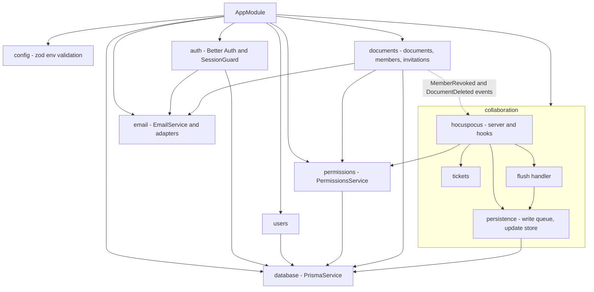

**Rules**

- `documents` and `collaboration` never import each other. The only link is an in-process event, which avoids a circular dependency.
- `email` has no dependencies on other feature modules. Callers pass it a finished message.
- `collaboration` imports nothing from REST controllers, so it can be extracted later.

### 2.2 Key classes

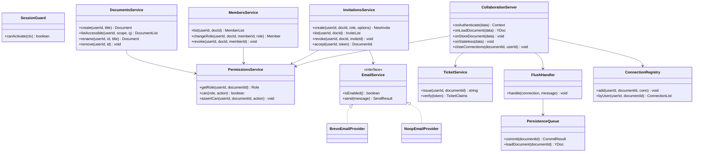

### 2.3 Permission model

| Operation                               | Owner | Editor | Viewer |
| --------------------------------------- | :---: | :----: | :----: |
| View                                    |  ✅   |   ✅   |   ✅   |
| Edit                                    |  ✅   |   ✅   |   ❌   |
| Rename                                  |  ✅   |   ❌   |   ❌   |
| Share (create invite links, email them) |  ✅   |   ❌   |   ❌   |
| Change roles, remove members            |  ✅   |   ❌   |   ❌   |
| Delete                                  |  ✅   |   ❌   |   ❌   |

One pure function backs every check, so REST and WebSocket cannot disagree:

```ts
type Role = "OWNER" | "EDITOR" | "VIEWER";
type Action =
  "view" | "edit" | "rename" | "share" | "manage_members" | "delete";

const ALLOWED: Record<Role, ReadonlySet<Action>> = {
  OWNER: new Set([
    "view",
    "edit",
    "rename",
    "share",
    "manage_members",
    "delete",
  ]),
  EDITOR: new Set(["view", "edit"]),
  VIEWER: new Set(["view"]),
};

export const can = (role: Role | null, action: Action) =>
  role !== null && ALLOWED[role].has(action);
```

`getRole(userId, documentId)` returns `OWNER` if `Document.ownerId` matches, otherwise the `DocumentMember.role`, otherwise `null`. A soft-deleted document returns `null` for everyone. Ownership lives **only** in `Document.ownerId`; `DocumentMember` rows are only `EDITOR` or `VIEWER`.

### 2.4 REST API

All routes are under `/api`. Everything except `/api/auth/*` and `/api/health*` needs a valid session.

| Method     | Path                                    | Min role | Purpose                                                                                       |
| ---------- | --------------------------------------- | -------- | --------------------------------------------------------------------------------------------- |
| `*`        | `/api/auth/*`                           | public   | Better Auth endpoints (do not recreate)                                                       |
| GET        | `/api/health`                           | public   | Liveness: no database call (keeps Neon asleep; used to wake Render)                           |
| GET        | `/api/health/ready`                     | public   | Readiness: includes a database check                                                          |
| GET, PATCH | `/api/users/me`                         | session  | Profile                                                                                       |
| POST       | `/api/documents`                        | session  | Create (caller becomes owner)                                                                 |
| GET        | `/api/documents?scope=owned\|shared&q=` | session  | List accessible documents, search by title                                                    |
| GET        | `/api/documents/:id`                    | viewer   | Metadata and the caller's role                                                                |
| PATCH      | `/api/documents/:id`                    | owner    | Rename                                                                                        |
| DELETE     | `/api/documents/:id`                    | owner    | Soft delete; closes live sockets                                                              |
| GET        | `/api/documents/:id/members`            | viewer   | Members (names only for non-owners)                                                           |
| PATCH      | `/api/documents/:id/members/:memberId`  | owner    | Change role                                                                                   |
| DELETE     | `/api/documents/:id/members/:memberId`  | owner    | Remove; closes that user's sockets                                                            |
| POST       | `/api/documents/:id/invitations`        | owner    | Create an invite link; returns the raw token once. Optional `email` also sends it (section 4) |
| GET        | `/api/documents/:id/invitations`        | owner    | List links (never tokens)                                                                     |
| DELETE     | `/api/documents/:id/invitations/:invId` | owner    | Revoke                                                                                        |
| POST       | `/api/invitations/accept`               | session  | `{ token }`, returns `{ documentId }`                                                         |
| POST       | `/api/collaboration/tickets`            | viewer   | `{ documentId }`, returns a 60-second ticket                                                  |

**Rules**

- Return **404, not 403**, for documents the caller cannot see at all, so ids do not leak.
- One error shape everywhere, with a stable `code` that the UI translates:

```json
{
  "statusCode": 403,
  "code": "FORBIDDEN",
  "message": "You do not have access to this document."
}
```

- Validate every body with zod (or class-validator, but not both on one route). Reject unknown fields.
- Non-owners see member names and roles only, never emails.
- Update `Document.updatedAt` at most once every 30 seconds per document, so a typing session does not cause a write per flush.

---

## 3. Authentication and sessions

**Design:** Better Auth runs inside `apps/api` and is the only session system. Next.js uses only its client. The browser reaches it through the Vercel rewrite, so the session cookie is first-party.

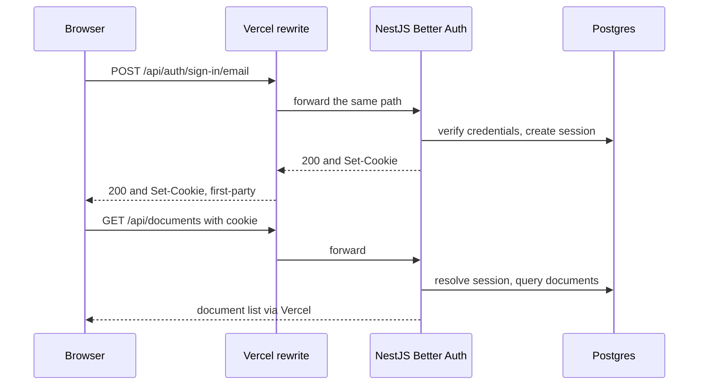

**Configuration rules** (⚠ Verify each against Better Auth's current docs)

- Mount Better Auth at `/api/auth/*` with Nest's body parser disabled for that route.
- Set its base URL and trusted origin to the **Vercel** URL, not the Render URL, so redirects and cookies match what the browser sees.
- Cookie: `HttpOnly`, `Secure`, `SameSite=Lax`. Add an `Origin` check on state-changing requests.
- Registration is open to any email. **Email verification and password reset are not part of the MVP** (decision D4): accounts are active immediately, there is no forgot-password flow, and Better Auth's verification and reset features stay disabled.
- Rate-limit sign-in and sign-up.
- Session expiry or revocation returns 401; the client moves to the Sync error flow, keeps local edits and offers sign-in.

### 3.1 Logout with unsynced work

Deleting local data on logout can destroy offline work; keeping it can leak data on a shared computer. So logout syncs first, then asks.

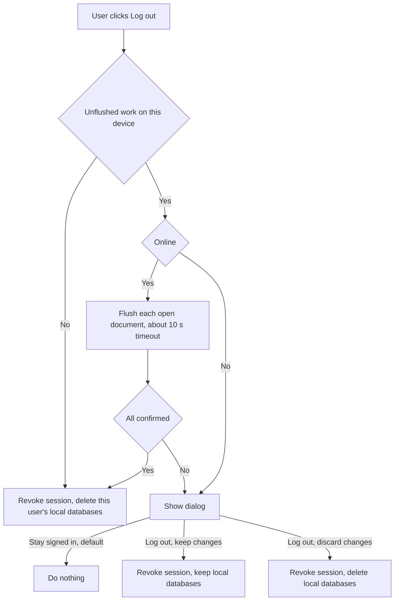

- Safe by default: discarding takes an explicit choice.
- **A session expiry is not a logout.** Never purge on expiry.
- Local data is not encrypted. Tell people on shared computers to choose "discard", in the dialog and the README.
- Broadcast logout to other tabs with a `BroadcastChannel`.
- Delete databases by names recorded in the metadata store, because listing databases is not reliably supported (⚠ Verify). Close providers first, because deleting an open database is blocked. Retry a failed purge on the next load.

---

## 4. Email module

**Purpose:** deliver a message to an address. Nothing else. It sits behind an interface so the provider can change without touching callers.

**Why not SMTP:** Render's free web services block outbound traffic on SMTP ports 25, 465 and 587 (since late September 2025). Port 25 stays blocked even on paid instances. An HTTPS API call uses port 443 and is not affected. (⚠ Verify the current Render documentation before deploy.)

### 4.1 Interface and adapters

```ts
export interface EmailMessage {
  to: string;
  subject: string;
  text: string; // always provided
  html?: string; // optional
  kind: "invite"; // for logging and rate limits; more kinds are future work
}

export type SendResult =
  | { sent: true; providerMessageId?: string }
  | { sent: false; reason: "disabled" | "rate_limited" | "provider_error" };

export interface EmailService {
  isEnabled(): boolean;
  send(message: EmailMessage): Promise<SendResult>; // never throws
}
```

| Adapter               | When used                                       | Notes                                                                                                                                   |
| --------------------- | ----------------------------------------------- | --------------------------------------------------------------------------------------------------------------------------------------- |
| `NoopEmailProvider`   | `EMAIL_ENABLED=false` (default)                 | Returns `{ sent: false, reason: "disabled" }`; the UI hides email options                                                               |
| `BrevoEmailProvider`  | `EMAIL_ENABLED=true` and `EMAIL_PROVIDER=brevo` | One `fetch` to Brevo's transactional endpoint with the API key header (⚠ Verify the endpoint, headers and payload against Brevo's docs) |
| `MemoryEmailProvider` | Tests                                           | Captures messages in memory so tests can assert on them                                                                                 |

Adding Resend later (needs a verified domain) means one new adapter and one env value.

### 4.2 Flows

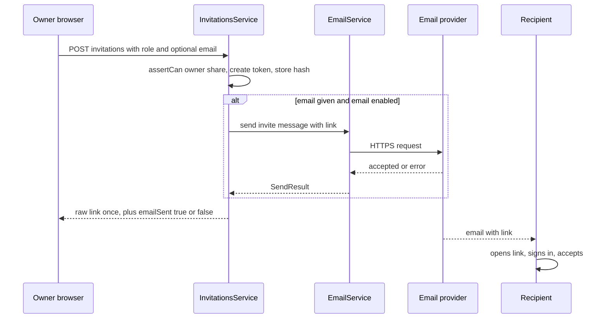

| Flow                                             | Who calls EmailService | Failure behavior                                                                                              |
| ------------------------------------------------ | ---------------------- | ------------------------------------------------------------------------------------------------------------- |
| Invite by email (the only email flow in the MVP) | `InvitationsService`   | Return the link anyway with `emailSent: false`; the UI says "Email could not be sent. Copy the link instead." |

### 4.3 Rules

- **Best effort, never blocking.** An email failure is logged and surfaced as a flag; it must never fail sign-up, sharing or editing. No retries or queue in the MVP.
- **Rate limits (starting values).** At most 5 invite emails per minute per user, 3 emails per hour to one address, and an in-memory daily budget set below the provider's free cap (for example stop at 250 of a 300-a-day cap). The counter resets on restart, which is acceptable at this scale. Without these limits, any account could burn your free quota by sending invites.
- **Emailed invite links are email-bound.** When an `email` is set on an invitation, it defaults to a single use, and accepting requires the signed-in user's email to match (case-insensitive). A mismatch returns the same generic "link invalid or expired" error.
- **Secrets stay out of logs.** Never log the API key, the raw token or the full link. Log kind, provider result and the hashed recipient.
- **Content:** inviter's display name, document title and the link. No document content.
- **Sender:** `EMAIL_FROM` must be a sender the provider has verified. Free-sender mail may land in spam, so **never make a demo depend on an email arriving**.
- **Provider caps and footer branding** on free plans (⚠ Verify current limits).

---

## 5. Database

Better Auth owns `User`, `Session`, `Account` and `Verification`. Generate them with its tooling; do not hand-write them (⚠ Verify). The tables below are ours.

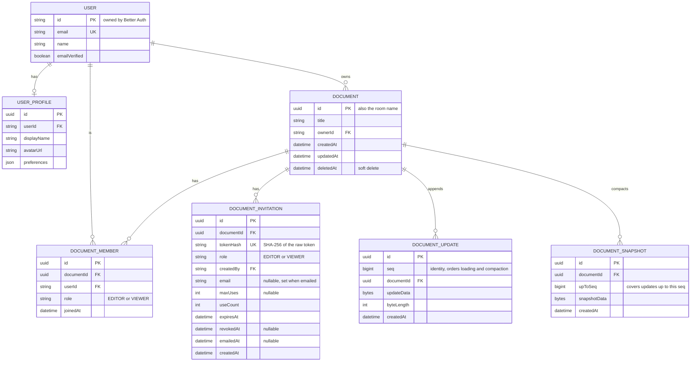

**Constraints and indexes**

- `UNIQUE (documentId, userId)` on members, and `CHECK role IN ('EDITOR','VIEWER')`.
- Indexes: `Document (ownerId, updatedAt DESC)` for the dashboard; `DocumentMember (userId)` for "shared with me"; `DocumentUpdate (documentId, seq)`; `DocumentSnapshot (documentId, upToSeq DESC)`. Add a `lower(title)` index only if search feels slow.
- Binary Yjs data is `bytea`, never JSON.
- Foreign keys everywhere, with cascade from `Document` to its members, invitations, updates and snapshots.
- Migrations use `DIRECT_URL`. The running app uses the pooled `DATABASE_URL` (⚠ Verify the Prisma and Neon setup).
- Prisma has no native `citext`; normalize emails (lowercase, trimmed) in the application.
- Email-bound invitations store the recipient address in `DocumentInvitation.email`; non-owners never see it.

**Post-MVP tables (designed, not built)**

- `DocumentVersion`: id, documentId, snapshotId (FK; the snapshot is kept while referenced), label, kind (MANUAL, AUTO, RESTORE), createdBy, createdAt. A restore never rewrites history: it applies the difference as a new update and records a new version.
- `DocumentActivity`: id, documentId, actorId, type (SHARED, ROLE_CHANGED, REVOKED, RESTORED), metadata, createdAt. Presence is never stored here.

---

## 6. Collaboration server

### 6.1 Connecting and authorizing

Browsers cannot set headers on a WebSocket, so the client first obtains a ticket through the proxied REST API and presents it in the Hocuspocus auth message, never in the URL.

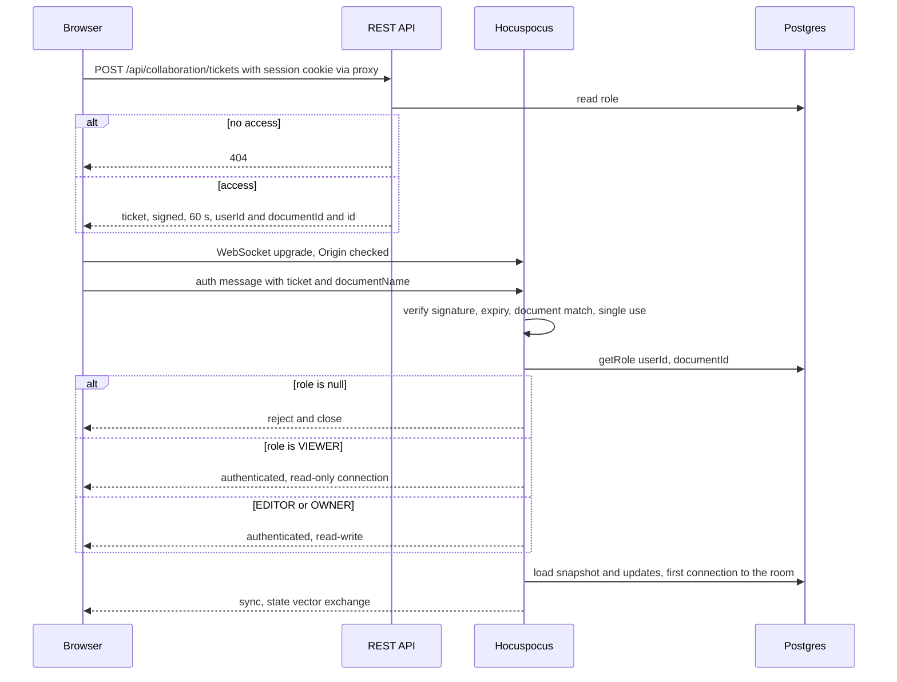

- **Ticket:** HMAC-signed claims `{ sub, doc, jti, exp }`, 60 seconds. Keep used `jti` values in memory until expiry (one instance, so this is enough). A ticket proves **identity only**; the role is always re-read from the database.
- The provider must fetch a **fresh ticket on every reconnect** (⚠ Verify that its `token` option accepts an async function).
- Check the `Origin` header on the upgrade against the allowed web origin.

### 6.2 Hooks

⚠ Verify every hook name and option against the pinned Hocuspocus version.

| Hook                                                     | Responsibility                                                                                     |
| -------------------------------------------------------- | -------------------------------------------------------------------------------------------------- |
| `onAuthenticate`                                         | Verify the ticket, read the role, set read-only for viewers, return `{ userId, role }` as context  |
| `onLoadDocument`                                         | Build the `Y.Doc`; set `lastCommittedSV` and `dirtySinceCommit = false`                            |
| `onChange` / document update                             | Set `dirtySinceCommit = true` (this also fires for delete-only edits)                              |
| `beforeHandleMessage` (if available)                     | Defense in depth: re-check the role from a short cache (about 30 s)                                |
| `onStoreDocument` (debounced, about 2 s with a 10 s max) | Call `PersistenceQueue.commit(documentId)`                                                         |
| `onStateless`                                            | Route `flush` messages to `FlushHandler`                                                           |
| `onDisconnect`                                           | Remove from the registry; Hocuspocus flushes when the last client leaves                           |
| Shutdown (`SIGTERM`)                                     | Stop accepting connections, flush every pending store, then exit (Render restarts on every deploy) |

### 6.3 Presence identity

Awareness is client-controlled, so never trust a name or color from it.

- The client publishes only `{ userId, cursor, selection }`.
- The UI resolves name and avatar from the member list (REST), and the color from a hash of `userId` into an 8-color palette. Nobody can impersonate another person's name.
- Awareness is never persisted.

### 6.4 Revocation and deletion

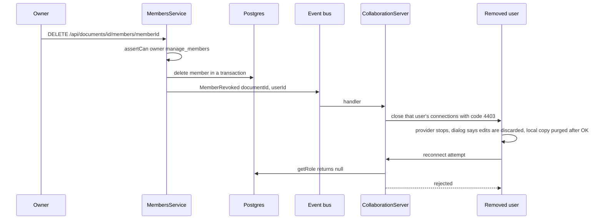

- Role change (for example Editor to Viewer): close the connection and let the reconnect re-authenticate with the new role. Do not flip a live connection's read-only flag.
- Document deleted: emit `DocumentDeleted`, close all its connections with `4404`, and each client purges its local copy.
- **Policy (decision D2, resolved):** when a user's access is removed, the client shows a dialog before anything is deleted:

  > You were removed from this document. Your unsynced changes cannot be synced and will be discarded.

  After the user dismisses it, the local copy of that document is deleted and they return to the dashboard.
  - The editor becomes non-editable as soon as the 4403 close arrives, so no further edits pile up while the dialog is open.
  - If the user was offline when removed, they find out on reconnect: the server rejects the join (`getRole` returns null) with 4403 and the same dialog appears.
  - If the tab closed before the dialog, the next load tries to connect, gets 4403, and shows the dialog then.
  - Downgrade from Editor to Viewer with unsynced edits is **not yet decided** (D7); the proposed default is the same dialog and discard.

### 6.5 Close codes and reconnect

| Code | Meaning                            | Client action                                                                                         |
| ---- | ---------------------------------- | ----------------------------------------------------------------------------------------------------- |
| 4401 | Unauthenticated or session expired | Refresh the session, then reconnect; if that fails, Sync error (sign in)                              |
| 4403 | Access revoked or forbidden        | Do not retry; show Recovery pending briefly, then the removal dialog (6.4), then purge the local copy |
| 4404 | Document missing or deleted        | Do not retry; show not found                                                                          |
| 1011 | Server error                       | Retry with backoff                                                                                    |

⚠ Verify that Hocuspocus allows custom close codes. If not, close the socket and let the next authentication fail with the right reason.

Reconnect uses exponential backoff with jitter, capped at about 30 seconds, and retries immediately on the browser's `online` event.

---

## 7. Persistence and the save acknowledgement

### 7.1 Storing and loading

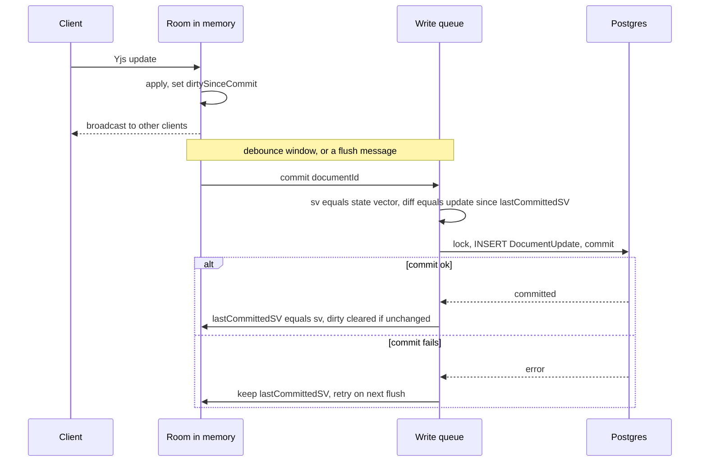

- **Load:** read the latest snapshot, then every update with `seq > upToSeq`, apply them to a fresh `Y.Doc`, then set `lastCommittedSV` to its state vector and clear `dirtySinceCommit`.
- Compute `sv` and the diff in the **same synchronous step**, and advance `lastCommittedSV` only after the commit.
- All writes for a document go through **one queue** (one at a time; a request arriving during a write is coalesced into one follow-up write). The same `pg_advisory_xact_lock` guards compaction, in case a deploy briefly overlaps two instances (⚠ Verify).
- Yjs updates are idempotent and commutative, so duplicate rows are harmless wasted space.
- Never write a full snapshot per keystroke. Keep Yjs garbage collection on (decision D6).

### 7.2 Snapshots and compaction (stretch goal)

When a room unloads with more than about 100 updates since the last snapshot, or on a scheduled sweep for idle documents:

1. Take the document lock; read the highest `seq` inside the lock (call it M).
2. Merge the latest snapshot and updates up to M.
3. Insert a snapshot with `upToSeq = M`.
4. Delete updates with `seq <= M`, in the **same transaction**.
5. Commit. A crash before commit leaves the old state intact.

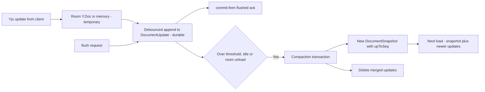

### 7.3 The flush protocol

The editor's store hook is debounced, so a delivered message proves nothing about Postgres. The client asks explicitly and the server answers only after a commit.

```ts
// Shared message types (move to @syncspace/contracts when that package exists)
type Flush = {
  type: "flush";
  nonce: string;
  epoch: number; // client's local edit counter at send time
  stateVector: string; // base64, the client's Y state vector
};
type Flushed = { type: "flushed"; nonce: string };
type FlushFailed = {
  type: "flush-failed";
  nonce: string;
  reason: "db_unavailable" | "behind" | "too_large" | "forbidden";
};
type PermissionChanged = {
  type: "permission-changed";
  role: "EDITOR" | "VIEWER";
};
```

**Server handling**

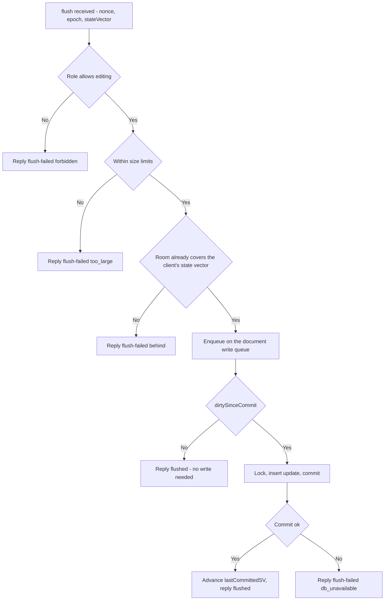

**Client rules**

- Keep only the **latest outstanding nonce**. Ignore any other reply.
- Mark **Saved** only when `flushed` matches the latest nonce **and** `epoch` still equals the current epoch. If the user typed since, stay on Syncing and send another flush.
- Send a flush:
  - after about 1.5 s of quiet (max wait 5 s during continuous typing, at most one per second);
  - right after the reconnect sync completes;
  - when the tab is hidden or closing (best effort).
- Run the reply timeout (about 15 s, one automatic retry) **only while connected**. Disconnecting is not an error: cancel the timer and flush again after the reconnect sync.
- A `behind` reply means "wait and retry shortly". Other failures show Sync error with a Retry action.
- Viewers never send `flush`.

**Why a `dirtySinceCommit` flag and not "is the diff empty":** as I understand Yjs, an encoded update always carries the document's delete set, so an empty-diff check would not work, and delete-only edits do not advance the state vector. A dirty flag set by every update (deletes included) is exact. Prove this in the spike (section 13).

**What the client does not do:** it does not trust the socket being open, an update being sent, or its own IndexedDB write as proof of server persistence.

---

## 8. Frontend

### 8.1 Routes and rendering

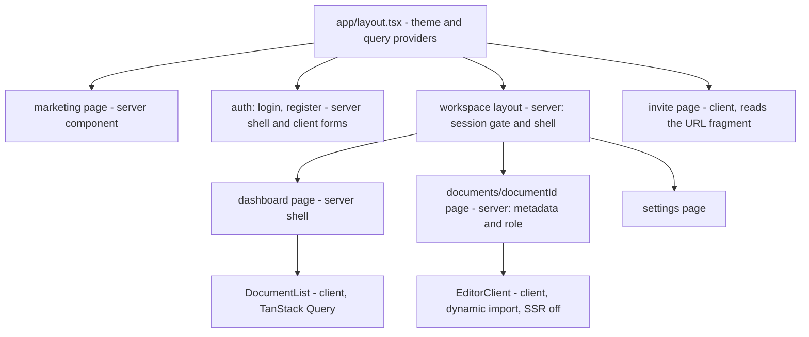

Client components only where interaction needs them (editor, lists, dialogs, forms). The shell, landing page and metadata stay server components. **No Next.js API routes:** the backend owns all business logic.

### 8.2 The document session

All Yjs, IndexedDB and provider logic lives in `features/document-sync/` as plain TypeScript, so it can be unit-tested without a DOM. React receives only a small interface: `status`, `pending`, `collaborators`, `retry()`.

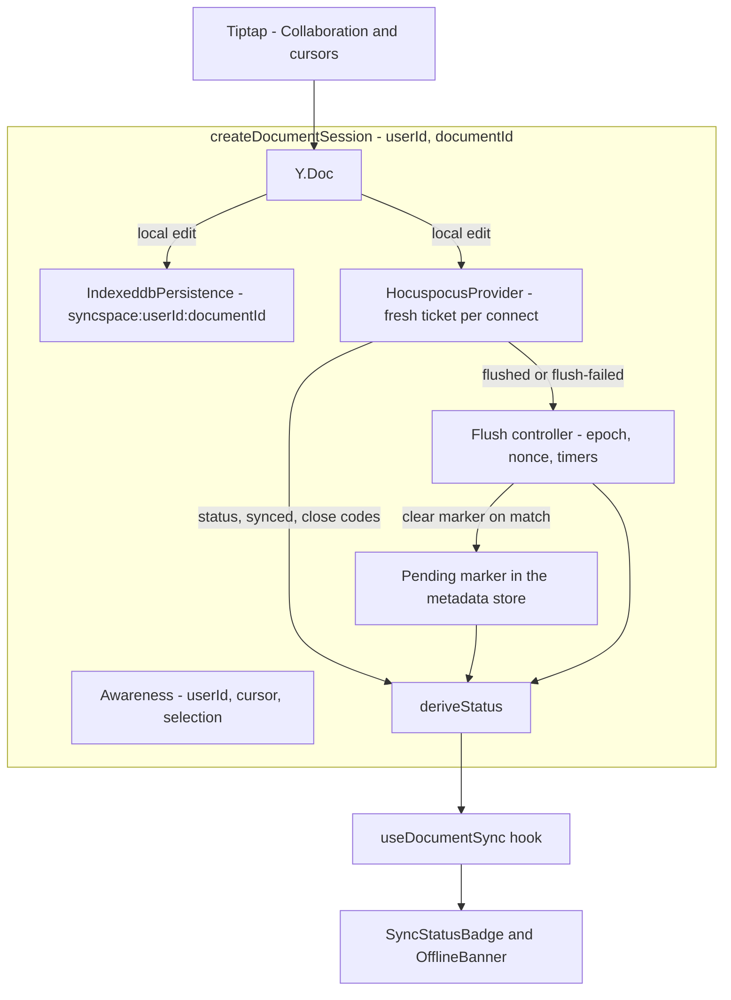

- Create the session when the editor mounts. Destroy the provider, persistence and awareness when it unmounts or the user logs out.
- **Never put the `Y.Doc` in React state or Zustand.** Yjs is the source of truth for content.
- Viewers get a non-editable editor (`editable: false`), in addition to the server-side read-only connection.

### 8.3 Pending marker (survives refresh)

An in-memory counter cannot tell, after a refresh, whether unsynced work exists. So:

1. Keep one tiny entry per document in `syncspace:{userId}:meta`.
2. Set it on the **first local edit**, in the same handler.
3. Clear it **only** when a `flushed` reply matches the current epoch. Never on a socket event or an IndexedDB write.
4. After every page load, treat the document as pending until a flush is confirmed in that session. A clean document still gets a flush after one round trip (the server skips the write). The worst case is a brief extra "Syncing", never a false "Saved".
5. The same store records which document databases exist and when each last fully synced, so logout can delete them by name.

### 8.4 Deriving the sync status

One pure function turns the inputs into one of eight states. It is table-testable and cannot reach an impossible state.

| Input           | Meaning                                                                                  |
| --------------- | ---------------------------------------------------------------------------------------- |
| `provider`      | connected, connecting or disconnected (the browser being offline counts as disconnected) |
| `synced`        | The initial server sync finished on this connection                                      |
| `pending`       | The pending marker is set                                                                |
| `flushError`    | `flush-failed`, or a reply timeout while connected                                       |
| `authError`     | Closed with 4401                                                                         |
| `needsRecovery` | Closed with 4403, or a role change conflicts with pending edits                          |

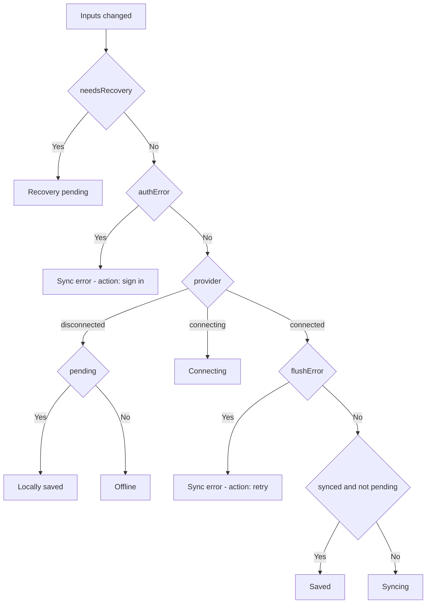

Display rules on top of the function:

- **Saving locally** is a brief transient after an edit, not a guarantee. y-indexeddb may not report when each write completes (⚠ Verify).
- Wait about 2 seconds after a disconnect before showing Offline or Locally saved, so brief blips do not flash the badge. This delays the display only; the real state updates immediately.
- Every state has a text label, an icon and an `aria-live` announcement. Color is never the only signal.

### 8.5 Offline model

"Cached on this device" is not the same as "available offline".

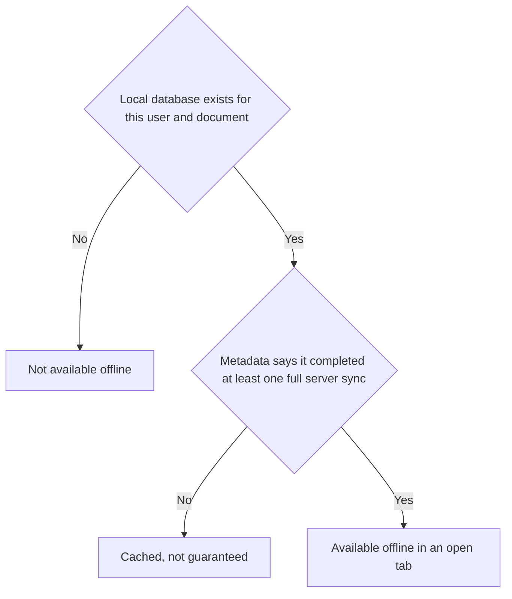

**What the MVP promises (decision D1, resolved: open tab only):** keep editing in an open tab when the network drops, your edits persist locally, they survive a reload once you are back online, and they merge on reconnect.

**What it does not promise:** reopening a closed tab, or refreshing, while still offline. That needs a service worker that caches the app shell, because the page's HTML and JavaScript must load without the network. App-shell caching is a post-MVP stretch goal; if it is added, this section gains a service-worker design. State the limit plainly in the README and show a clear message in the UI when the app is opened without a connection.

**Account isolation:** database names are `syncspace:{userId}:{documentId}`, and another account never opens them. Ask for persistent storage with `navigator.storage.persist()` and warn if it is not granted, because Safari may evict unused site storage (⚠ Verify).

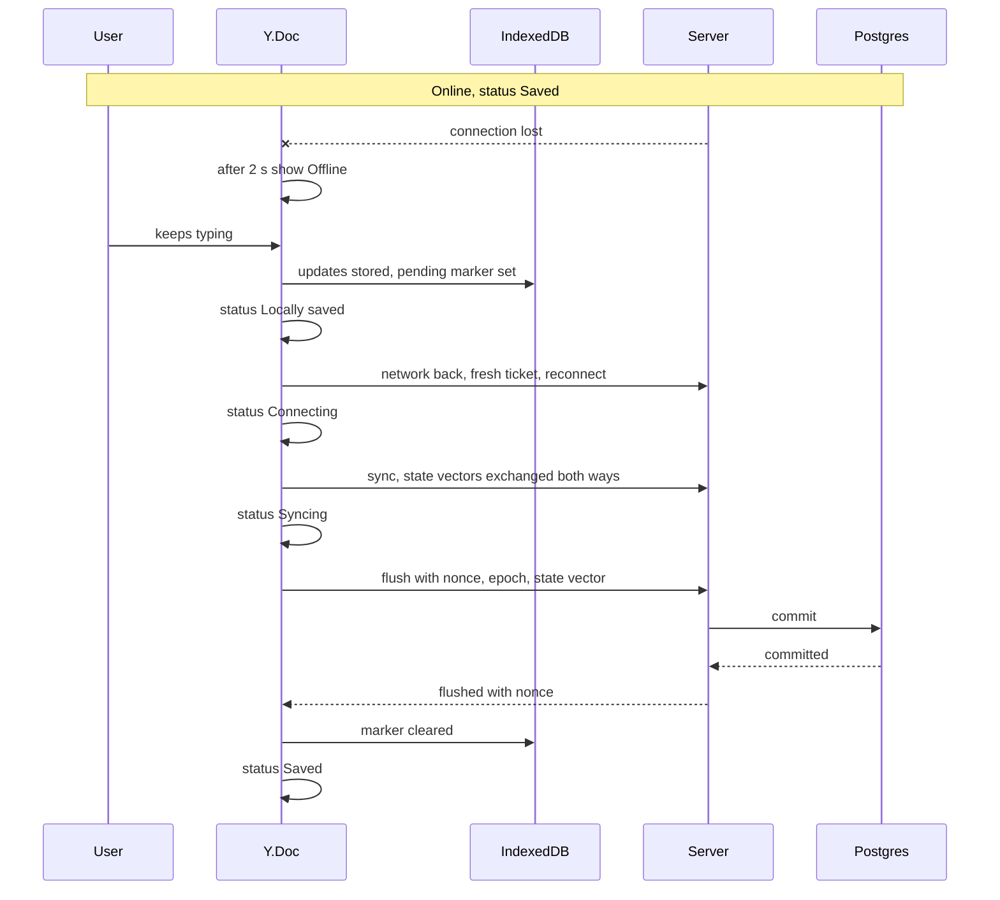

### 8.6 State ownership

| Kind of state                             | Owner                                    |
| ----------------------------------------- | ---------------------------------------- |
| Server data (documents, members, profile) | TanStack Query                           |
| Document content                          | Yjs                                      |
| Presence                                  | Yjs awareness                            |
| Sync status                               | `deriveStatus` through `useDocumentSync` |
| UI preferences (sidebar, dialogs)         | Zustand                                  |
| Theme                                     | next-themes                              |
| Navigation and search text                | URL                                      |

One fact, one owner. Never copy document text into React state.

### 8.7 Editor, layout and theme rules

- **Tiptap schema allowlist:** headings, paragraphs, bold, italic, underline, strike, bullet and ordered lists, blockquote, code block, link, horizontal rule. Nothing else, and no raw HTML from paste.
- **Links:** allow only `http`, `https` and `mailto`; add `rel="noopener noreferrer"`.
- **Layout:** mobile-first; `min-h-dvh` (not `100vh`); tap targets at least 44 px; editor column about 720 px on wide screens; no horizontal page scroll at 320 px. Test at 320, 375, 768, 1024 and 1440 px.
- **Theme:** next-themes with `suppressHydrationWarning`; Light, Dark and System; semantic tokens only. Test flash-of-wrong-theme on first paint.
- **i18n-ready:** all user-visible strings come from one messages module (English now), and the API's error `code` maps to a message there.
- Call `GET /api/health` on app load to wake the API early.

---

## 9. Sharing with invite links

Invite links need no email provider. Everyone who joins becomes a real member, so roles, revocation and per-user storage keep working. Emailing the link is optional (section 4).

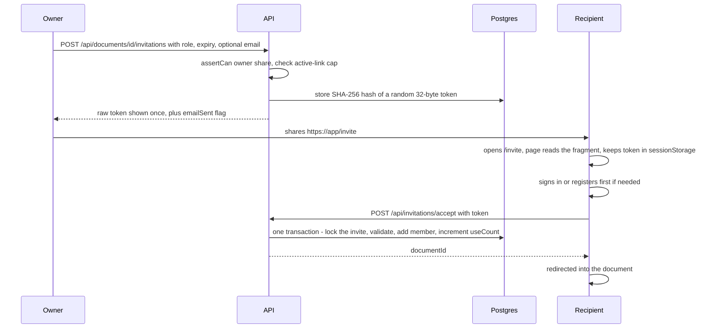

**Rules**

- The token lives in the **URL fragment**, which browsers do not send to servers, so it stays out of Vercel and Render logs and referrer headers.
- Defaults: multi-use for copied links, 7-day expiry (options 1 and 30 days, never "no expiry"), optional use cap, Editor or Viewer only (never Owner), at most 10 active links per document.
- **Emailed links** are single-use and bound to the recipient's address (section 4.3).
- Accepting never changes an existing role. An existing member just sees "You already have access".
- Return one generic "link invalid or expired" for unknown, expired, revoked or exhausted tokens, so nobody can probe which exist.
- Revoking a link stops new joins. People who already joined stay until the owner removes them, and the UI says so.
- Rate-limit create and accept.

---

## 10. Security checklist

| Area                                 | Rule                                                                                                                                             |
| ------------------------------------ | ------------------------------------------------------------------------------------------------------------------------------------------------ |
| Identity                             | Session cookie (`HttpOnly`, `Secure`, `SameSite=Lax`) plus an `Origin` check on mutating requests (⚠ Verify Better Auth defaults)                |
| Authorization                        | `PermissionsService` on every REST handler and every WebSocket connect; role always from the database                                            |
| WebSocket                            | Single-use 60-second ticket in the auth message (not the URL), `Origin` check on upgrade, read-only viewers, role re-check on a short cache      |
| Rich-text safety                     | Schema allowlist, no raw HTML paste, restricted link protocols, security headers and a CSP (⚠ Verify Tiptap's defaults)                          |
| Email                                | Never SMTP; invites only; API key only in platform settings; rate limits and a daily budget; emailed links are email-bound                       |
| Public-demo limits (starting values) | Max update message about 1 MB, document state about 5 MB, 50 documents per user, 20 members per document, 10 active invite links per document    |
| Rate limits (starting values)        | Sign-in and sign-up about 10 per minute per IP, tickets about 30 per minute per user, invite accept about 10 per minute per IP                   |
| Secrets                              | Only in platform settings and a local `.env`; never `NEXT_PUBLIC_*` except harmless URLs; separate dev and production values; the repo is public |
| Logging                              | Log userId, documentId and connection id; never tokens, tickets, cookies, API keys, links or document content                                    |
| Demo accounts                        | Hold no real data; profile and password changes disabled; periodic reset                                                                         |
| Local data                           | Namespaced per account, purged on logout (with the unsynced-work dialog); not encrypted, and documented as such                                  |

---

## 11. Failure scenarios and tests

Each failure scenario maps to a test that must exist before the demo.

| #   | Scenario                                                       | Expected behavior                                                                  | Test                                                      |
| --- | -------------------------------------------------------------- | ---------------------------------------------------------------------------------- | --------------------------------------------------------- |
| 1   | Offline edit, then reload the page once the connection is back | Local edits are intact and then sync                                               | Playwright, `setOffline`                                  |
| 2   | Offline edit, then reconnect                                   | Edits merge, then Saved after the flush confirms                                   | Playwright                                                |
| 3   | Backend restarts mid-edit                                      | Clients reconnect, resend, converge, return to Saved                               | Integration                                               |
| 4   | Database unavailable                                           | `flush-failed`; Sync error with Retry; recovers when the database returns          | Integration (inject a Prisma failure)                     |
| 5   | Socket drops while typing                                      | Offline or Locally saved, auto-reconnect, converge                                 | Integration                                               |
| 6   | Session expires                                                | Sync error (sign in); local edits kept                                             | Integration and Playwright                                |
| 7   | Permission revoked while connected                             | Connection closed, writes rejected, removal dialog shown, then local copy purged   | Integration (two providers) and Playwright for the dialog |
| 8   | Two users edit one paragraph                                   | Both edits kept; documents identical                                               | Integration (two providers)                               |
| 9   | Long offline period                                            | Everything delivered on reconnect                                                  | Integration                                               |
| 10  | Sign out, another account signs in                             | The second account cannot see the first's data                                     | Playwright                                                |
| 11  | Duplicate updates                                              | No corruption; documents identical                                                 | Unit                                                      |
| 12  | Restart before the commit finishes                             | Never Saved without a matching flush; resends after reconnect                      | Integration                                               |
| 13  | Delete-only edit, then flush                                   | Not falsely Saved before the commit                                                | Integration                                               |
| 14  | Same document open in two tabs                                 | Both converge; no duplicate-write problems                                         | Playwright                                                |
| 15  | Invite link expired, revoked, exhausted or reused              | One generic error; no access gained                                                | Integration                                               |
| 16  | Email provider down or key invalid                             | Invite link still returned with `emailSent: false`; sign-up and sharing unaffected | Integration (stubbed provider)                            |
| 17  | Email daily budget reached                                     | Further sends return `rate_limited`; UI offers the copy-link path                  | Unit                                                      |
| 18  | Emailed link opened by a different account                     | Generic "invalid or expired"; no access                                            | Integration                                               |

**Deliberately not supported in the MVP (decision D1):** reloading or reopening the page while the device is still offline. There is no test for it; the README states the limit.

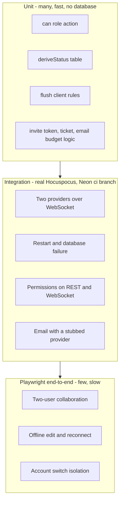

- Vitest runs the API unit and e2e tests, with Supertest for HTTP and the Hocuspocus provider in Node for WebSocket tests. Add SWC decorator-metadata config once a service uses constructor injection (Nest relies on metadata that Vitest does not emit by default).
- Playwright drives the browser, using `context.setOffline(true)` for offline paths. Test Chromium and WebKit.
- Keep database-backed tests uncached in Turborepo, and give every run its own document ids.
- CI runs install, formatting, lint, typecheck, build and tests on every pull request. Integration tests use the separate Neon `ci` branch through a repository secret. Email tests never call a real provider.

---

## 12. Configuration and deployment

### 12.1 Environment variables

Validate all of them with zod when the API starts, so a missing secret fails fast.

| Variable                        | Where        | Public? | Notes                                               |
| ------------------------------- | ------------ | ------- | --------------------------------------------------- |
| `DATABASE_URL`                  | api          | No      | Neon pooled connection string                       |
| `DIRECT_URL`                    | api          | No      | Neon direct string, migrations only                 |
| `BETTER_AUTH_SECRET`            | api          | No      | Random; different per environment                   |
| `BETTER_AUTH_URL`               | api          | No      | The **Vercel** app URL, not Render's                |
| `WEB_ORIGIN`                    | api          | No      | Allowed `Origin` for REST and the WebSocket upgrade |
| `COLLAB_TICKET_SECRET`          | api          | No      | Signs WebSocket tickets                             |
| `PORT`                          | api          | No      | Set by Render; default 4000; listen on `0.0.0.0`    |
| `EMAIL_ENABLED`                 | api          | No      | `false` by default                                  |
| `EMAIL_PROVIDER`                | api          | No      | `brevo` (only when enabled)                         |
| `EMAIL_API_KEY`                 | api          | No      | Secret; never logged                                |
| `EMAIL_FROM`, `EMAIL_FROM_NAME` | api          | No      | Must be a sender the provider has verified          |
| `EMAIL_DAILY_BUDGET`            | api          | No      | Set below the provider's free daily cap             |
| `API_URL`                       | web (server) | No      | Render URL, used only by the rewrite                |
| `NEXT_PUBLIC_WS_URL`            | web          | Yes     | Render's WebSocket URL (a URL, not a secret)        |

The earlier brief listed `EMAIL_SERVER_HOST`, `EMAIL_SERVER_PORT` and similar SMTP variables, and `NEXT_PUBLIC_API_URL`. They are replaced by the API-based email variables and the `/api` rewrite.

### 12.2 Deploy steps

1. **Neon:** create one project. Use `main` for production only, plus one `dev-<name>` branch per developer and a `ci` branch. Never use production locally.
2. **Render (free web service):** root directory `apps/api`. Build with Corepack and Yarn, generate the Prisma client, build Nest, and run `prisma migrate deploy` (as a build or pre-deploy step; ⚠ Verify what the free plan supports). Start with `node dist/main.js`. Set `HUSKY=0`.
3. **Vercel:** root directory `apps/web`, install from the repo root, set `HUSKY=0`. Add the rewrite below.
4. **Prove the skeleton early** (before feature work): sign in, refresh, call the ticket endpoint, open a WebSocket to Render, and time a cold start, in Chrome and Safari.

```ts
// apps/web/next.config.ts (shape only; ⚠ Verify the current syntax)
async rewrites() {
  return [
    { source: "/api/:path*", destination: `${process.env.API_URL}/api/:path*` },
  ];
}
```

### 12.3 Operations

- **Wake-up:** the web app calls `GET /api/health` on load, so Render starts waking before the user needs it. Warm Render and Neon a minute before any demo.
- **Graceful shutdown:** on `SIGTERM`, flush all pending stores before exit.
- **Logs:** structured, one line per event, with documentId and connection id. Count connections, flush successes, flush failures, reconnects and emails sent or failed.
- **Backups:** the free tier is not a backup plan. Document a manual, encrypted `pg_dump` command, and never commit dumps or upload them as public artifacts.
- Never store durable data on Render's filesystem.

---

## 13. Early spikes

Do these before building features on top of them. Each is a pass or fail check.

| #   | Spike                                                                                                                                  | Day           |
| --- | -------------------------------------------------------------------------------------------------------------------------------------- | ------------- |
| 1   | Better Auth inside Nest and behind the Vercel rewrite: cookie set, session survives refresh in Chrome and Safari                       | 1             |
| 2   | A cold Render through the rewrite: does the first request complete within Vercel's limit (⚠ Verify)?                                   | 2             |
| 3   | Hocuspocus on the Nest server, ticket authentication, custom close codes, read-only connections                                        | 4             |
| 4   | Message order on one connection, including a delete followed immediately by a flush                                                    | 4             |
| 5   | A flush replies `flushed` only after the commit; killing the server before the commit never ends in Saved                              | 4 to 5        |
| 6   | A clean document replies `flushed` without writing                                                                                     | 5             |
| 7   | Two clients typing at once never produce a false Saved (compare full document states)                                                  | 5             |
| 8   | y-indexeddb: observe updates for the pending marker; delete a database after closing the provider                                      | 8             |
| 9   | Delete-only edits set `dirtySinceCommit` and are committed                                                                             | 5             |
| 10  | **Email:** one HTTPS call from the live Render service to the chosen provider reaches an inbox from a single verified sender (no SMTP) | Before Day 11 |

**Fallback if message ordering cannot be relied on (spike 4):** have the client send the flush only after the server acknowledges its latest update (⚠ Verify that Hocuspocus exposes such an acknowledgement).
